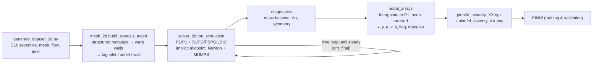

# CFD pipeline (`ns_cfd/`) — design notes

These notes explain what the CFD code in `ns_cfd/` does and why it was built the way it was.
Its job is to produce reference blood-flow fields for training and testing the PINN (see `PINN.md`).

---

## 1. What is in the folder

| File | Status | Role |
|---|---|---|
| `mesh_2d.py` | **in use** | 2D stenosed-channel mesh built directly in DOLFINx, boundaries tagged (default: symmetric `crossed` triangles) |
| `solver_2d.py` | **in use** | Incompressible Navier–Stokes solver (FEniCSx / DOLFINx 0.11) |
| `generate_dataset_2d.py` | **in use** | Command-line driver: mesh → solve → export `.npz` + field plot + **mesh sheet** for each severity |
| `mesh_plots.py` | **in use** | Mesh inspection: element quality and the one-page mesh troubleshooting sheet |
| `mesh_study.py`, `mesh_study/` | **in use** | Mesh-independence study (§9) and its results |
| `stability_test.py`, `stability/` | **in use** | Disturbance test of the symmetric flow (§9; P1/P1 and P2/P1 rows, §11) |
| `cost_study.py`, `cost_study/` | **in use** | CFD accuracy-vs-cost matrix (mesh × element × solve mode) against a 700×112 reference: the CFD side of the CFD-vs-PINN comparison. Run on the A4000 (`docs/SETUP.md`) |
| `zuluaga_check.py`, `zuluaga_check/` | **in use** | Stability check on the labmate's 75 % geometry and formulation (§13) |
| `wall_shear.py` | **in use** | Wall shear stress (element-wise ∇u, analytic wall normal) and recirculation length from WSS sign changes |
| `verify_poiseuille.py`, `verification/` | **in use** | Exact-solution check in the straight channel (§11) |
| `tests/` | **in use** | `python -m pytest -q tests`: Poiseuille checks (P2/P1 exact to round-off; legacy outlet defect detected) |
| `output_2d/` | data | Datasets at Re ≈ 301 (u_max = 0.2 m/s), severities 20–70 %, `crossed` mesh, **P2/P1, steady solve** (regenerated 2026-11-08). Symmetric up to 50 %; 55–70 % are the bent-jet branch, tagged `branch: asymmetric` (§12) and skipped by the PINN |
| `output_2d_re150/` | data | Datasets at Re ≈ 150 (u_max = 0.1 m/s), severities 20–70 %, same settings. Symmetric up to 60 %; 65–70 % asymmetric |
| `logs/` | log | Generation logs of the 30–70 % sweep (§12) |

Retired code and data live in `old/` (see `old/README.md`): the first 2D prototype, the 3D skeleton,
`PINN_mvp`, the first datasets made on the asymmetric `right`-diagonal mesh, and the `crossed`-mesh
datasets made with the original P1/P1 + symmetric-viscous scheme (`old/datasets_crossed_P1P1/`, see §11).

Environment: conda env **`fenicsx-env`** (Python 3.11, DOLFINx 0.11, PETSc 3.25 with MUMPS).

---

## 2. Pipeline



Run:
```bash
conda activate fenicsx-env
cd ns_cfd
python generate_dataset_2d.py --severities 0.20 0.25 0.30 0.35 0.40 0.45 0.50   # Re ≈ 301
python generate_dataset_2d.py --u-max 0.1 --t-final 4.0 --output-dir output_2d_re150 \
       --severities 0.20 0.25 ... 0.60                          # Re ≈ 150
```

---

## 3. Geometry and mesh (`mesh_2d.py`)

**Geometry.** A straight 2D channel with a smooth, symmetric cosine stenosis:

```
r(x) = R · [1 − (s/2)·(1 + cos(π·(x − x_c)/L_s))]   for |x − x_c| ≤ L_s,   r = R elsewhere
```

`s` is the **severity, defined as the diameter reduction at the throat** (s = 0.5 means the throat
diameter is half the healthy diameter).

| Parameter | Default | Why |
|---|---|---|
| `radius` R | 2.5 mm (D = 5 mm) | Same healthy diameter as the original prototype; coronary/carotid order of magnitude |
| `length` L | 50 mm (10 D) | The original 30 mm domain was too short for the flow behind the stenosis to recover |
| `x_center` x_c | 10 mm (2 D) | Keeps the inlet 1.2 D before the stenosis starts; the original had only 5 mm |
| `half_length` L_s | 4 mm | Stenosis spans 6–14 mm, giving smooth walls without kinks |
| `nx × ny` | 250 × 40 | h ≈ 0.2 mm axially and 0.125 mm radially in the healthy section; finer at the throat. Verified by the mesh study (§9) |
| `diagonal` | `crossed` | 4 triangles per cell, mirror-symmetric about y = 0. The former `right` default (2 triangles per cell) seeded artificial asymmetry (§9) |

**Mesh construction.** A structured triangular rectangle `[0, L] × [−R, R]` is generated (each cell split into 4 triangles by its diagonals: 40,000 triangles, 20,291 nodes), and each
node's y-coordinate is scaled by `r(x)/R`. Inlet, outlet and wall facets are tagged **after** the warp,
so the wall tag follows the curved boundary (inlet = 1, outlet = 2, wall = 3).

**Decision: no CadQuery / Gmsh for 2D.**
- In `fenicsx-env`, CadQuery cannot be imported (§8), and Gmsh is not installed.
- A warped structured mesh is enough in 2D, and its symmetric nodes make the symmetry check (§5) exact.
- The same analytic `r(x)` is re-implemented in the PINN. A unit test checks that it matches the CFD wall nodes to 1e-9.

---

## 4. Solver (`solver_2d.py`)

### Physics
Incompressible, Newtonian Navier–Stokes:

| Parameter | Value | Note |
|---|---|---|
| ρ | 1055 kg/m³ | blood density |
| μ | 0.0035 Pa·s | Newtonian blood viscosity (non-Newtonian effects ignored) |
| u_max | 0.2 m/s (also 0.1 m/s) | **peak** inlet velocity |
| Re = ρ·u_max·D/μ | **≈ 301** (≈ 150 for u_max = 0.1) | ⚠ based on the *peak* velocity; the mean-velocity Re is 2/3 of this (≈ 201 / 100) |

### Discretisation
> **Changed on 2026-11-08 (§11).** The default is now **Taylor–Hood P2/P1 without stabilisation**, the
> viscous term is in **gradient form** μ∇u:∇v, and datasets use a **direct steady Newton solve**.
> The original scheme described below is still available as `element="P1P1", viscous_form="sym"`
> (the mesh-study and stability-test tags without a scheme suffix refer to it).

- **Elements (original):** P1/P1 (equal-order) mixed velocity–pressure space. These are cheap, but they need stabilisation.
- **Stabilisation:** SUPG + PSPG + LSIC (residual-based, Tezduyar-type):
  - τ_M = [(2/Δt)² + (2|u|/h)² + (4ν/h²)²]^(−1/2), and τ_C = h|u|/2.
  - The LSIC term is multiplied by ρ. This fixes the original prototype, where the missing ρ made LSIC about 1000× too weak.
  - The viscous term is dropped from the strong residual, because second derivatives vanish for P1.
- **Time integration:** implicit midpoint for momentum, using u_mid = ½(uⁿ⁺¹ + uⁿ).
  - Continuity is imposed at n+1.
  - Pressure is treated as the n+½ Lagrange multiplier. The prototype averaged pressure in time, which can cause pressure oscillations.
- **Quadrature degree capped at 4.** UFL's automatic estimate for the `sqrt` inside τ_M is huge. Without the cap, Jacobian assembly took 0.8 s per call (about 10× slower overall), with no accuracy benefit for P1 fields.

### Boundary conditions
| Boundary | Condition | Why |
|---|---|---|
| Inlet (x = 0) | Parabolic Poiseuille profile u = u_max(1 − (y/R)²), **ramped** as ½(1 − cos(πt/t_ramp)), t_ramp = 0.1 s | Avoids the impulsive start of the prototype, which needs more Newton iterations and gives unphysical transients |
| Walls | No-slip u = 0 | Rigid vessel |
| Outlet (x = L) | "Do-nothing" (the natural condition of the weak form) + backflow stabilisation −½ρ·min(u·n, 0)·(u·v) | No pressure Dirichlet condition is needed. The backflow term prevents blow-up if a vortex reaches the outlet. **With the gradient-form viscous term the natural condition is −p n + μ ∂u/∂n = 0, satisfied exactly by fully developed outflow with p = 0. With the original symmetric form it is σ·n = 0, which Poiseuille flow violates (§11)** |

### Nonlinear / linear solver
- Monolithic Newton through DOLFINx `NonlinearProblem` (PETSc SNES `newtonls`, basic line search).
  Tolerances: rtol 1e-8, atol 1e-10, at most 25 iterations, and an error is raised if it does not converge.
- Direct LU with MUMPS. The 2D systems are small (about 31k dofs), so a direct solver is the robust choice.
- `generate_dataset_2d.py` sets `OMP_NUM_THREADS=1`. With threaded BLAS inside MUMPS the CPU was
  oversubscribed: CPU time was about 9× wall time and runs were slower.

### Time loop and steady-state criterion
- Δt = 2 ms. Implicit midpoint is unconditionally stable, and SUPG's τ includes Δt.
- The run stops when the **relative change in velocity per step is below 1e-6** after the ramp has ended.
  Otherwise it stops at `t_final` (2 s by default; 4 s for Re ≈ 150, where the flow takes longer to develop).
- Steadiness is measured on **velocity only**. Pressure is close to zero when the ramp ends, so including
  it gave misleading relative changes.
- The dataset is the **steady** solution. Time snapshots are optional (`--snapshot-every N`), for future time-dependent PINNs.

---

## 5. Diagnostics stored with every case
| Quantity | Meaning |
|---|---|
| `mass_error` | \|Q_in − Q_out\| / Q_in from boundary flux integrals (about 1e-16 in all runs) |
| `dp` | Boundary-averaged pressure inlet − outlet [Pa] |
| `symmetry_error` | max\|u(x, y) − u(x, −y)\| / max\|u\| over mirrored nodes. About 1e-3 for symmetric flow, O(1) once the jet bends to one wall |
| `steady`, `t_end`, `final_rel_change` | Whether and when the steady criterion was met |
| `u_max_field` | Peak velocity in the domain |

---

## 6. Export format (`generate_dataset_2d.py`)
Per severity: `pinn2d_severity_XX.npz`, the field plot `pinn2d_severity_XX.png` and the mesh sheet
`pinn2d_severity_XX_mesh.png` (same sheet as the mesh study, §9). The `.npz` contains:

| Key | Content |
|---|---|
| `x, y` | Node coordinates [m] |
| `u, v, p` | Velocity [m/s] and pressure [Pa] at the nodes |
| `flag` | 0 = interior, 1 = inlet, 2 = outlet, 3 = wall (inlet/outlet take precedence at corners) |
| `triangles` | Mesh connectivity (for plotting / interpolation) |
| `meta` | JSON: all solver parameters, geometry, diagnostics (§5) |
| `t_snap, u_snap, …` | Only when `--snapshot-every` is used |

**Decision: interpolate to plain P1 spaces before export.** In a mixed space the solver's value
ordering does **not** match `domain.geometry.x`. The prototype's plot assumed it did: 496 of 561
values were drawn at the wrong node, so `old/ns_cfd_legacy_2d/stenosis_50_velocity.png` does not show the real flow.
The exporter interpolates u and p into P1 spaces that share one dofmap and takes coordinates from
that dofmap. Export is serial-only, since the meshes are small.

---

## 7. Results

> These tables come from the **first datasets on the `right`-diagonal mesh** (now in
> `old/datasets_right_diagonal/`). The symmetry thresholds below are affected by that mesh (§9).

### Re ≈ 301 (u_max = 0.2 m/s)
| Severity | Steady | Δp [Pa] | max\|u\| [m/s] | Symmetry error | Usable |
|---|---|---|---|---|---|
| 20 % | ✔ | 12.21 | 0.223 | 2.0e-3 | ✔ |
| 25 % | ✔ | 12.81 | 0.233 | 1.9e-3 | ✔ |
| 30 % | ✔ | 13.67 | 0.244 | 2.5e-3 | ✔ |
| 35 % | ✔ | 14.89 | 0.259 | 3.3e-3 | ✔ |
| 40 % | ✔ | 16.66 | 0.276 | 4.0e-3 | ✔ |
| 45 % | ✔ | 19.27 | 0.298 | 4.8e-3 | ✔ |
| 50 % | ✔ | 23.19 | 0.324 | 6.8e-3 | ✔ |
| 55 % | ✘ | 29.21 | 0.358 | 6.0e-2 | ✘ |
| 60–75 % | ✘ | 40–149 | 0.40–0.64 | 0.78–0.92 | ✘ |

### Re ≈ 150 (u_max = 0.1 m/s, t_final = 4 s)
| Severity | Steady | Δp [Pa] | Symmetry error | Usable |
|---|---|---|---|---|
| 20–55 % | ✔ | 6.03 → 11.37 | 1.5e-3 – 3.5e-3 | ✔ |
| 60 % | ✔ (t = 1.64 s) | 14.07 | 5.9e-3 | ✔ |
| 65 % | ✘ | 18.36 | 7.3e-2 | ✘ |
| 70 % | ✘ | 26.30 | 0.72 | ✘ |

Sanity checks on the 50 % case at Re ≈ 301:
- The wall velocity is exactly 0.
- The velocity profile recovers to Poiseuille by the outlet (peak 0.209 m/s against 0.2 at the inlet).
- Backflow (u < 0) is captured behind the throat.

### Symmetry breaking: a physical limit, not a solver bug
Above a critical Re and severity, the 2D jet behind a stenosis bends towards one wall (a Coanda-type
bifurcation). The symmetric solution still exists but is unstable, so the solution is non-unique.
At Re ≈ 301 this starts at about **55 %**; at Re ≈ 150, at about **65 %**.
The PINN loader therefore rejects cases with `steady = False` or `symmetry_error > 0.05`.
Lowering Re is how the usable severity range was extended.

Runtime: a few minutes per case on one core. Higher severities take longer to reach steady state.

---

## 8. Legacy and unfinished code (moved to `old/`)

**`old/ns_cfd_legacy_2d/original_solver.py` (prototype).** It runs under DOLFINx 0.11, but its outputs should not be used:
- the plot misplaces nodal values (§6);
- it runs only 0.03 s after an impulsive start, while one pass of fluid through the domain takes about 0.2 s, and `early_stop_tolerance` is never used;
- the inlet and outlet are too close to the stenosis;
- the LSIC term is missing ρ.

**3D pipeline (`old/ns_cfd_3d/`: `mesh_generator.py`, `solver.py`, `generate_dataset.py`).** These are skeletons:
- `build_cadquery_solid` is undefined, and the O-grid meshing steps are only comments;
- `solver.py` never solves for pressure, applies no inlet BC, has its stabilisation commented out, and uses APIs that are removed or nonexistent in DOLFINx 0.11 (`FunctionSpace`, `gmshio`, `dolfinx.io.get_petsc_options`);
- `generate_dataset.py` passes point indices where DOLFINx expects cell indices to `Function.eval`.

**CadQuery cannot be imported in `fenicsx-env`.** `import cadquery` fails with
`libvtkWrappingPythonCore3.11.so: cannot open shared object file`:
- pip's `cadquery-ocp` requires `vtk==9.6.2`;
- conda's `vtk-base 9.6.2` satisfied that requirement on paper, so pip never installed its own VTK wheel;
- OCP links against the wheel's unversioned library names (`libvtkCommonCore.so`), but conda ships only versioned ones (`…-9.6.so`).

Recommended fix: a separate geometry environment (`mamba create -n cq-env -c conda-forge cadquery python-gmsh`)
that writes `.msh` files for `fenicsx-env` to read. Force-reinstalling pip's VTK over conda's is not recommended.

---

## 9. Mesh-independence study (`mesh_study.py`)

**How the production mesh was chosen.** The 250 × 40 mesh was picked by judgement: about 40 cells
across D and h ≈ 0.1–0.2 mm, with a few minutes of run time per case. It had not been verified.
Three specific concerns:
- **Axial spacing is uniform.** Δx = 0.2 mm everywhere, so the shear layer behind the throat
  (thickness roughly D/√Re ≈ 0.3 mm) spans only 1–2 cells axially.
- **The (former) default `right` diagonal makes the triangulation asymmetric about y = 0,** even though the
  nodes are symmetric. The aspect-ratio map in the mesh plots shows this: elongated cells sit
  upper-left in the converging part and lower-right in the diverging part. This could seed the
  symmetry breaking.
- **The steady discrete solution depends slightly on Δt,** because the stabilisation τ_M contains (2/Δt)².

**Method.**
- Three nested meshes, 125×20, 250×40 and 500×80 (refinement ratio 2).
- The warp is applied node by node, so every coarse node is also a fine node. Fields are compared
  node by node with no interpolation error.
- Discretisation error is estimated with the **Grid Convergence Index** (Roache; Celik et al. 2008):
  observed order p, Richardson extrapolation, and GCI = 1.25·|e|/(rᵖ − 1).
- Quantities of interest: Δp, max |u|, centreline u and p at the throat, separation and reattachment
  points, recirculation length (from where the wall-adjacent row of u changes sign on the upper wall),
  and node-wise velocity/pressure differences against the fine mesh.

| Study part | Cases |
|---|---|
| GCI | 25 % and 50 % at Re ≈ 301; 60 % at Re ≈ 150. Three meshes each |
| Threshold check | 55 % at Re ≈ 301 and 65 % at Re ≈ 150, on 250×40 `right`, 250×40 `crossed` (symmetric, 4 triangles per cell) and 500×80 `right` |
| Δt check | 50 % at Re ≈ 301, 250×40, Δt = 1 ms against 2 ms |

```bash
python mesh_study.py mesh --severity 0.5 --nx 250 --ny 40 --diagonal right   # mesh sheet only, no solve
python mesh_study.py batch --workers 6     # all runs; skips finished runs, so it can be resumed
python mesh_study.py report                # mesh_study/report/report.md, gci_table.csv, plots
```

**Mesh troubleshooting sheets** (`mesh_study/plots/mesh_<tag>.png`, written before every solve):
- the full mesh with boundary-tag colouring and the analytic wall overlaid;
- zooms on the stenosis and on the throat wall;
- maps of minimum angle and aspect ratio;
- grid spacing along x (Δx, and Δy of the wall-adjacent row);
- quality histograms;
- a header with cell and node counts, h_min/h_max, minimum angle, maximum aspect ratio and the number of inverted cells.

A field plot (`fields_<tag>.png`) is also saved for every run.

### Results (full tables in `ns_cfd/mesh_study/report/report.md`)

**Production mesh error estimates** (GCI on the 250×40 mesh; "vs fine" = node-wise relative-L2 difference against 500×80):

| Quantity | 25 % Re≈301 | 50 % Re≈301 | 60 % Re≈150 | Verdict |
|---|---|---|---|---|
| Δp | GCI 1.1 % | GCI 1.6 % | GCI 0.3 % | ✔ meets the < 2 % target |
| Velocity field vs fine | 0.05 % | 0.24 % | 0.32 % | ✔ far below PINN errors (0.5–5 %) |
| Pressure field vs fine | 0.18 % | 0.91 % (max 0.68 Pa at the throat) | 0.67 % | ✔ for PINN use |
| Pressure at throat centre | — | GCI 6.0 % | GCI 4.8 % | ⚠ local throat pressure is less converged |
| Recirculation length | (none) | GCI 10.8 % (9.0 mm against 9.8 extrapolated) | GCI 10.3 % | ✘ underpredicted by about 8 % |
| Reattachment point | — | GCI 3.7 % | GCI 3.4 % | ≈ acceptable |

- **Conclusion for the PINN:** the production mesh is adequate. The CFD reference error in velocity and
  pressure is an order of magnitude below the current PINN errors, so the existing datasets stay valid.
- **For wake studies** (recirculation length, wall shear) use the 500×80 mesh or refine Δx in the wake.
  Part of the recirculation-length change comes from the measurement itself: the wall-adjacent row
  moves closer to the wall on finer meshes.
- **The observed order for Δp at Re ≈ 301 is low (p ≈ 0.3–0.4)** while the differences are tiny
  (about 0.1 Pa). The solution is probably not yet in the asymptotic range, possibly because of the
  O(h) stabilisation terms. Treat the extrapolated values as indicative.
- **Δt also matters.** Halving Δt (2 → 1 ms) changes the steady Δp by 0.7 % and the recirculation
  length by 2.9 %, comparable to the mesh error. This comes from the (2/Δt)² term in τ_M. Use
  Δt = 1 ms for high-accuracy reference data.

**The symmetry-breaking thresholds depend on the triangulation:**

| Case | 250×40 `right` | 250×40 `crossed` (symmetric) | 500×80 `right` |
|---|---|---|---|
| 55 % Re≈301 | unsteady, symmetry error 0.060 | **steady, perfectly symmetric (8e-16)** | unsteady, 0.043 |
| 65 % Re≈150 | unsteady, 0.073 | **steady, perfectly symmetric (8e-16)** | unsteady, 0.19 |

- With a symmetric mesh, the cases previously rejected converge to a symmetric steady state.
- With the asymmetric `right` mesh they don't, even after refinement. On coarser `right` meshes the
  baseline asymmetry is larger (50 %: 0.022 coarse, 0.0068 medium, 0.0039 fine), so the triangle
  orientation clearly feeds an asymmetric perturbation into the flow.
- **What this does not settle** (resolved by the stability test below): whether the symmetric state is *stable* at 55 % / 65 %. A symmetric
  mesh only perturbs the flow at round-off level, which may not grow within 2–4 s even if the flow is
  unstable. The decisive test is the `crossed` mesh plus a small explicit asymmetric perturbation
  (for example in the inlet profile or initial condition). If the perturbation decays, the thresholds
  were mesh artefacts and the PINN severity range can be extended; if it grows, the bifurcation is physical.

### Stability test (`stability_test.py`): the symmetry breaking is physical

The question left open by the mesh study was whether the symmetric flow at 55–70 % is stable or only
looked steady because the symmetric mesh never disturbs it. To test it:
- An antisymmetric, zero-flux disturbance ε·η(1 − η²) (η = y/R, ε = 0.01, peak 0.4 % of u_max) was
  added to the inlet for t < 0.2 s. The inlet was then symmetric again.
- The asymmetry a(t) = max|v| on the centreline / u_max was tracked.
- σ is the late-time growth rate, fitted after the post-disturbance minimum.
- Mesh 250×40 `crossed`, t ≤ 6 s.

| Re | Severity | σ (1/s) | Verdict |
|---|---|---|---|
| ≈ 301 | 50 % (control) | −1.91 | **stable**: the disturbance decays |
| ≈ 301 | 55 % | +0.86 | **unstable** |
| ≈ 301 | 60 % | +3.21 | **unstable** |
| ≈ 301 | 65 %, 70 % | +4.6, +2.1 | **unstable**: saturates into the deflected jet (symmetry error 0.9) |
| ≈ 150 | 60 % (control) | −1.17 | **stable** |
| ≈ 150 | 65 % | +0.85 | **unstable** |
| ≈ 150 | 70 % | +2.71 | **unstable**: saturates (symmetry error 0.72) |

- **The critical severity lies between 50 and 55 % at Re ≈ 301, and between 60 and 65 % at Re ≈ 150.**
  These are the same limits found originally with the `right` mesh. The old mesh did not create the
  instability; it only *triggered* it, the way any real disturbance would.
- The steady symmetric `crossed` solutions at 55 % / 65 % in the mesh study were **unstable
  equilibria**: they persisted only because nothing perturbed them.
- **Consequence for the PINN:** the training ranges stay 20–50 % (Re ≈ 301) and 20–60 % (Re ≈ 150).
  Above them the physical steady flow is the asymmetric (Coanda) state, which has two mirror-image
  solutions, so it cannot be represented by a symmetric-in-severity surrogate.
- Caveats:
  - The cases growing at about 0.9/s stopped at 3 s when the steady criterion triggered (the change
    per step was below 1e-6 while growing slowly), so they did not reach saturation. That doesn't affect the verdict.
  - Growth rates of the saturating cases (65–70 % at Re ≈ 301) are only indicative.
  - The threshold could be refined further with runs at 52.5 % and 62.5 %.

Results: `ns_cfd/stability/report/report.md` and `asymmetry_vs_time.png`. Mesh and field plots per case are in `ns_cfd/stability/plots/`.

### Is the mesh asymmetric at the stenosis? (checked 2026-11-08)
A direct check on the default `crossed` mesh at 65 %: every one of the 40,000 triangles, including
all 6,400 in the stenosis region, has an exact mirror image about y = 0, and the nodes mirror to
4e-19 m. The `right` mesh has **no** mirrored triangle. The symmetric solutions also stay
symmetric to 1e-15 in every steady P2/P1 run. So the bending at 55 %+ (Re ≈ 301) and 65 %+ (Re ≈ 150)
is not caused by the mesh: on this mesh a 0.4 % disturbance decays below the threshold and grows above it.
This is the classical **Coandă / pitchfork bifurcation of planar channel expansions**: the symmetric
solution still exists but becomes unstable above a critical Re (Cherdron, Durst & Whitelaw 1978;
Sobey & Drazin 1986; Fearn, Mullin & Cliffe 1990). Axisymmetric tubes stay symmetric to much higher Re,
so the bending is a property of the **planar** model, not of stenoses in general.

## 10. Known limitations / open items
- Rigid walls, Newtonian blood, steady inflow. No pulsatile waveform yet; `--snapshot-every` makes a time-dependent dataset possible.
- At high severities the off-centre jet still reaches the outlet. A longer domain (`--length 0.08`) would be needed there.
- Re is quoted with the peak inlet velocity. State this clearly when comparing with literature, which often uses the mean velocity.

## 11. Pressure correction (2026-11-08): outlet condition and pressure stabilisation

**Trigger.** The advisor found the pressure results confusing and suspected an error, because the
PINN pressure error (2–4 %) was much larger than the velocity error (0.2–0.7 %).

**Diagnosis.** The equations were right: the interior gradient in a straight channel was 0.1 % from exact,
and the 50 % throat pressure drop matches a Bernoulli estimate. Two **discretisation defects** were found
with the exact Poiseuille solution (`verify_poiseuille.py`, s = 0, results in `verification/poiseuille.json`):

| Variant | Mesh | max \|v\|/U | outlet p spread | Δp error | p rel-L2 |
|---|---|---|---|---|---|
| P1/P1 + symmetric viscous (original) | 125×20 / 250×40 | 3.4 % / 4.0 % | 0.05 / 0.20 Pa | −2.6 % / −1.3 % | 1.5 % / 1.1 % |
| P1/P1 + gradient viscous | 125×20 / 250×40 | 0.29 % / 0.08 % | 0.04 / 0.016 Pa | −1.7 % / −0.8 % | 0.4 % / 0.17 % |
| **P2/P1 + gradient viscous (new)** | 125×20 / 250×40 | **1e-15** | **1e-14 Pa** | **3e-14** | **1e-13** |

(Steady solves. Time-marched P1/P1 gives somewhat smaller Δp errors, 0.6–1.4 %, because τ_M then contains the
(2/Δt)² term. That Δt dependence was already visible in §9.)

1. **Outlet (main defect).** The weak form 2μ ε(u):ε(v) has the natural condition σ·n = 0. Fully developed
   flow has wall shear μ ∂u/∂y ≠ 0 at the outlet, so it cannot satisfy it. The solver then bends the flow
   near the outlet (spurious v up to 4 % of u_max) and the outlet pressure is non-uniform
   (−0.05 … +0.32 Pa across the section in every old dataset). The PINN imposed p = 0 uniformly there,
   so **CFD and PINN were solving slightly different problems**. A 0.3 Pa offset is about 2.5 % of Δp,
   the same size as the PINN pressure error. Fix: gradient form μ∇u:∇v (valid because ∇·u = 0).
   Its natural condition −p n + μ ∂u/∂n = 0 is satisfied exactly by Poiseuille outflow with p = 0.
2. **PSPG inconsistency.** For P1 the viscous term of the strong residual vanishes, so PSPG penalises the
   true pressure gradient wherever it balances viscosity (Poiseuille regions). That gives errors of about 0.1–0.3 Pa
   at the inlet and outlet, Δp about 1 % low, and the very low observed GCI order for Δp (p ≈ 0.3–0.4) in §9.
   Fix: Taylor–Hood P2/P1, which is inf-sup stable and needs no pressure stabilisation (guide §5.1).

**Effect on the stenosis cases** (250×40; old dataset vs new P2/P1 steady):
Δp changes by −0.9 % to +1.1 % (50 %: 23.12 → 22.87 Pa, matching the old study's Richardson-extrapolated
22.9 Pa). The pressure field changes by 0.9–3.2 % rel-L2 and the velocity by 0.2–0.5 %. **The old CFD reference
pressure was itself off by about as much as the PINN error**, so part of the "PINN pressure error" was reference error.

**New P2/P1 mesh study** (steady, `crossed`; `mesh_study/report/report.md`, "P2/P1" sections):

| | 25 % Re≈301 | 50 % Re≈301 | 60 % Re≈150 |
|---|---|---|---|
| observed order, Δp | 1.97 | 1.94 | 1.93 (old: 0.3–0.4) |
| GCI Δp on 250×40 | 0.03 % | 0.25 % | 0.35 % (old: 1.1–1.6 %) |
| 250×40 vs 500×80, velocity / pressure | 0.01 / 0.04 % | 0.06 / 0.24 % | 0.08 / 0.25 % |
| recirculation length GCI on 250×40 | – | 13 % | 10 % |
| wall time 125×20 / 250×40 / 500×80 | 5 s / 25 s / 2 min | | |

The solution is now in the asymptotic range. 250×40 stays the production mesh. For recirculation length
and WSS-type quantities use 500×80 (2 min per case), as before.

**Steady solve.** `steady_solve=True` solves the steady equations directly by Newton with continuation in
the inlet amplitude (typically 3 levels and 9–11 Newton iterations). On 125×20 at 50 % it matches the
time-marched P2/P1 solution to 6e-6 (velocity) and 7e-5 (pressure), in 6 s instead of 233 s. Time-marching a
steady problem is the "weak baseline" the guide warns against (§5.5), so this is also the CFD side of the
cost comparison. Caveat: Newton also converges to the *unstable* symmetric solution above the bifurcation,
so steady solves must stay inside the stable range established by `stability_test.py`.

**Pressure plots.** Pressure is gauge pressure (outlet = 0), so negative values behind the throat are the
physical pressure minimum and partial recovery. Plots now use a diverging colormap centred at 0. The PINN
evaluation adds centreline and wall p(x) curves plus WSS (`pressure_lines_severity_XX.png`) and
gauge-independent pressure metrics (mean-removed L2; RMS, max and offset error in units of Δp).

**Datasets** were regenerated with P2/P1 + gradient form + steady solve. The new exports add the
wall shear stress (`wall_idx`, `tau_w`), QoIs (peak WSS, separation/reattachment, recirculation length),
and per-case `_run_manifest.json` / `_cost.json`. The old ones are in `old/datasets_crossed_P1P1/`.
**Stability thresholds re-checked with P2/P1** (`stability/report/report.md`, P2P1/grad rows; 125×20,
same nodes as the P1 250×40 runs; ~20 min per case):

| Re | Severity | σ P1/P1 (original) | σ P2/P1 (corrected) | Verdict |
|---|---|---|---|---|
| ≈ 301 | 50 % | −1.91 | −2.25 | stable |
| ≈ 301 | 55 % | +0.86 | +0.53 | **unstable** |
| ≈ 150 | 60 % | −1.17 | −1.34 | stable |
| ≈ 150 | 65 % | +0.85 | +0.68 | **unstable** |

The critical severities do not move (50–55 % at Re ≈ 301, 60–65 % at Re ≈ 150), so the PINN training
ranges stay. The bifurcation is a property of the flow, not of the discretisation.

## 12. Severity sweep 30–70 % and branch selection (2026-11-08)

The CFD datasets now cover the literature range 30–70 % at both Re (the old 20 %/25 % cases are kept).
Above the planar symmetry-breaking threshold the symmetric steady state is unstable, so the plain
steady Newton solve (which stays symmetric on the mirror-symmetric mesh) would return a non-physical
state. `solver_2d.run_simulation(..., steady_solve=True, asym_eps=0.3)` instead:

1. continues the inlet amplitude 0 → 1 with a small transverse body force
   f_y = eps·ρ·u_max²/R on 0.01 ≤ x ≤ 0.02 m (throat to ~2.5 D downstream), then
2. continues eps → 0 (Newton, adaptive step).

Below the threshold this returns to the symmetric solution (symmetry error 1e-14–1e-9, Δp identical
to the previous datasets); above it, it lands on the stable bent-jet steady state. The result does not
depend on eps (0.3 and 1.0 give the same state at 65 %), and the centreline asymmetry matches the
saturated perturbed transient runs on the same 125×20 P2/P1 mesh to 3 digits (65 %/70 % Re≈301:
0.2374/0.3908 Newton vs 0.237/0.391 transient; 70 % Re≈150: 0.2570 vs 0.257).

P2/P1 stability runs at 65 % Re≈301 (σ = +4.47/s), 70 % Re≈301 (+1.95/s) and 70 % Re≈150 (+2.55/s; still
slowly evolving at 6 s) are all unstable, as with P1/P1 (`ns_cfd/stability/report/report.md`).
`generate_dataset_2d.py --asym-eps 0.3` is the default; each case gets `meta["branch"]`
(`symmetric` if symmetry error < 1e-6, else `asymmetric`). Tests: `ns_cfd/tests/test_branch.py`.

| Re | symmetric (PINN range) | asymmetric (CFD only) |
|---|---|---|
| ≈301 | 20–50 % | 55, 60, 65, 70 % (Δp 28.8, 38.8, 55.4, 84.8 Pa) |
| ≈150 | 20–60 % | 65, 70 % (Δp 18.2, 25.7 Pa) |

This matches the stability test exactly. The PINN loader (`PINN/pinn/data.py`) skips `asymmetric`
cases, so the PINN is only trained and tested on stable symmetric flows.

Caveats for the asymmetric cases: the jet can bend either way (the sign here is set by the
imperfection: towards +y); recirculation QoIs in `meta["qoi"]` are for the upper wall only, which is no
longer representative of both walls; the bent steady state was checked against transient runs on 125×20 P2/P1
(the datasets use 250×40). The cost study keeps `asym_eps=0` (all its cases are below the threshold).

### Root-cause audit of the asymmetry (2026-11-08)

Question: model, implementation or mesh? Checks (all P2/P1 steady with the imperfection continuation unless
stated). First run on 2026-11-08 with throw-away scripts; since 2026-11-12 most rows are reproducible with
`ns_cfd/asymmetry_audit.py` (22 distinct steady solves + 11 mesh checks, ~35 min on the laptop; tables in
`ns_cfd/asymmetry_audit/report.md`). Column "audit" says which rows the script reproduces.

| Check | Result | audit |
|---|---|---|
| Mesh nodes, triangles, boundary tags mirror-symmetric | yes, exactly, on every mesh the audit uses (11 meshes: 125×20 to 500×40, 50/55/70 %, L 50–100 mm; nodes to 4e-19 m). 2026-11-08: also 65 % | ✔ |
| Inlet profile, BCs, weak form (`solver_2d.py`) | symmetric: parabolic inlet in y/R, no-slip both walls, do-nothing outlet, no y-biased terms | code review only |
| Plain steady solve on the symmetric mesh (55 %, Re≈301) | stays symmetric to 5.5e-15 although unstable (nothing seeds the mode) | ✔ |
| Unperturbed transient on the symmetric mesh | stays symmetric to 1e-15 over the simulated time (2026-11-08; at his 75 % geometry round-off does grow, §13) | ✘ (transient runs: `stability_test.py`, `zuluaga_check.py`) |
| Threshold vs downstream length (50 → 100 mm) | unchanged: 55 % bent, asym 0.0709 both on 250×40 (2026-11-08: 0.0656 both on 125×20) | ✔ (250×40) |
| Threshold vs upstream length (2 D → 6 D) | unchanged (55 % bent, asym 0.0709; 50 % symmetric) | ✔ |
| Threshold vs mesh (125×20 → 250×40) and element (P1/P1 vs P2/P1) | unchanged: P2/P1 asym 0.0655 → 0.0709; P1/P1 bends more (0.12 → 0.10), same branch | ✔ |
| Re scan at 70 % | symmetric up to Re 75, bent from Re 100 (Re on D and u_max) | ✔ |
| Re scan at 50 % | symmetric up to Re 400, bent at Re 500 | ✔ |

Conclusion: it is a property of the **planar 2D model** (Navier–Stokes in a symmetric channel expansion
has a supercritical pitchfork: Cherdron, Durst & Whitelaw 1978; Sobey & Drazin 1986; Fearn, Mullin &
Cliffe 1990), not of the implementation or the mesh. The old `right`-diagonal mesh only *seeded* the
unstable mode; it did not create it. Order-of-magnitude check: Fearn et al. report Re_c ≈ 40 for a
1:3 sudden expansion (Re on upstream half-width and centreline velocity); the same definition here gives
Re_c ≈ 38–50 for 70 % (expansion ratio 3.3). An axisymmetric tube at the same severity loses symmetry
only at Re_c ~ 400–2350 (guide §4.3, Griffith 2008) and not as a steady jet bend.

Implication for the guide: its laminar guard (Re_peak ≤ 250 for DS ≤ 60 %, ≤ 150 for DS ≥ 70 %) comes
from axisymmetric thresholds and does not protect a planar model: planar Re_c at 70 % is ≈ 75–100.

## 13. Comparison with a labmate's solver (Zuluaga 2026)

Source: `thesis_docs/Documento trabajo de grado Juan Jose Zuluaga version final_compressed.pdf` and
github.com/JuanJoZP/cfd-hemodynamic (`src/scenarios/stenosis_pressure_structured.py`,
`src/solvers/stabilized_schur_pressure_backflow.py`; code read through summaries, confirm details at source).

**Both models are planar 2D** (channel in x, y; walls at y = R_in ± r(x)); neither is axisymmetric. His
"radially symmetric" structured mesh (gmsh transfinite + recombine → quads, even cell count across) is
mirror-symmetric about the centreline: the same property as our `crossed` mesh. Severity
R_min = (1 − η) R is the same definition as ours.

| | Zuluaga | ours |
|---|---|---|
| equations | incompressible NS, Newtonian, ρ 1060, μ 3.5 mPa s | same (ρ 1055) |
| time / nonlinear | implicit midpoint + Newton, dt 1e-4 s, from rest | same in transient mode; datasets use direct steady Newton |
| elements | P1/P1 + SUPG/PSPG/LSIC (LSIC with Tezduyar z factor) | P2/P1 Taylor–Hood (legacy P1/P1 identical to his) |
| viscous term | symmetric 2μ ε(u):ε(v) | gradient μ ∇u:∇v (same interior equations) |
| inlet | weak pressure (70 mmHg thesis, 80 code default) + Nitsche u_T = 0 | Dirichlet parabolic velocity |
| outlet | weak pressure p = R·Q (explicit, damped) + backflow penalty | zero traction (do-nothing, grad form) |
| flow rate | output (Re varies with severity) | input (Re fixed) |
| geometry | linear taper 1.57 → 1.20 mm, cubic Bézier lesion (slope α), L = 138 mm | cosine lesion, no taper, L = 50 mm |

Notes on his formulation:
- The P1 PSPG residual drops the viscous term, the inconsistency that biased our Δp 1–2.6 % low (§11);
  it would bias his FFR the same way.
- His outlet prescribes a pressure, not σ·n = 0 with free shear, so it does not have our old outlet
  defect A.
- To ask him: the outlet pressure term carries a factor 0.5 in the code, and the inlet uses a halved
  mmHg constant (`_MMHG_2D`). Since R_distal ≫ R_vessel these roughly cancel in Q, but they should be
  explained.

**Symmetry.** His Re ≈ 204 uses mean velocity and full height, which is ≈ our Re ≈ 301 case
(Re_mean,H = 201). There our planar threshold is 50–55 %, so his η = 0.75 (expansion ratio 4) is far
above it; the 21 % flow loss at 75 % does not change that. On Fearn et al.'s definition (half-width,
centreline velocity) his Re ≈ 150, against Re_c ≈ 40 for a 1:3 expansion. On a mirror-symmetric mesh
nothing seeds the antisymmetric mode, so the symmetric state persists even when unstable. This is what
we see without perturbation (§9, §12). His symmetric-mesh result is reproducible only by a steady solve or a short transient (see the test below), and
it is the unstable equilibrium; the bent, wall-attached steady jet on the unstructured mesh is the
physical planar solution. "Laminar" does not imply "symmetric". The "Re < 500 stays symmetric" rule is
from axisymmetric tubes (Griffith 2008; guide §4.3), and even there b = 0.9 gives Re_c ≈ 395 (75 % DS
= 94 % AS). His FFR agreeing within 2 % between meshes is consistent: bending changed our local Δp by
≈ 7 % at 65 %, which is diluted over a 138 mm vessel.

**Our sanity checks:** straight channel dp/dx 223.7 vs exact 224.0 Pa/m; Poiseuille WSS 0.56 Pa exact
(P2); throat mean velocity = U/(1 − s) by mass conservation (his +300 % at 75 % also matches the 4×);
thresholds independent of domain length, mesh, element and solver.

**Open item:** his TAWSS is 5–10× below a Poiseuille estimate at his stated flow (distal 4.8 dyn/cm² vs
≈ 24 dyn/cm² at 280 mm/s, H 2.41 mm). This is partly from averaging from rest over 0.5 s, against a
planar development time ≈ 0.7 s. His actual steady Q and Re decide how far above the threshold his
75 % case is.

### Stability test on his 75 % geometry (`zuluaga_check.py`, 2026-11-08)

His tapered Bézier geometry (η 0.75; α 0.3 and 0.05) on our mirror-symmetric `crossed` mesh, 690×24
(0.2 mm cells), P2/P1, his ρ/μ. His target flow is imposed as a parabolic inlet (Re_mean ≈ 204), with
dt 2 ms. Outputs and table are in `ns_cfd/zuluaga_check/` (`report.md`).

| run | result |
|---|---|
| steady Newton, no imperfection (α 0.3 / 0.05) | symmetric (asym 1e-14), Δp 552.9 / 1070.8 Pa |
| steady Newton, imperfection 0.3 → 0 (α 0.3 / 0.05) | bent jet, asym 0.667 / 0.146, Δp 583.5 / 1083.3 Pa |
| steady, α 0.3 at 78 % flow (Re 159, his flow-loss bound) | symmetric and bent branches both exist (asym 0.32) |
| transient, perturbed 1 % for t < 0.2 s, α 0.05 | σ = +9.5 1/s → UNSTABLE, saturates on the bent branch |
| transient, perturbed, α 0.3 | saturated before the fit window → UNSTABLE; ends at the Newton bent state |
| **transient from rest, no perturbation, α 0.3 (his procedure)** | asym grows from round-off: 1e-15 → 4e-12 (0.4 s) → 1e-7 (1.0 s) → 1e-4 (1.4 s) → 0.34 (1.8 s); fitted σ = +18.2 1/s; ends at t 3.17 s on the Newton bent state (asym 0.667, Δp 583.5 Pa) |

Conclusions:
- On a perfectly mirror-symmetric mesh, the symmetric 75 % flow does **not** survive a long transient.
  Round-off alone seeds the antisymmetric mode, and it grows ≈ e¹⁷ per second, so the flow is bent
  after about 1.8 s of simulated time. Only a direct steady solve (or a short run) keeps it symmetric.
  This corrects the "should be reproducible" expectation above.
- The perturbed transients end exactly on the steady Newton bent states (same Δp, same asym), so the
  branch continuation and the transient agree.
- His symmetric result is therefore consistent with the unstable equilibrium seen only for a short time.
  With his dt 1e-4 s, simulating ≲ 1 s, and SUPG/LSIC diffusion slowing growth, the symmetric state can
  look converged before the mode reaches visible size. Ask him how long he simulated, and what
  centreline v / asymmetry his final 75 % field has.
- Bending changes Δp by only 1–5.5 % here (583.5 vs 552.9 Pa), consistent with his small FFR difference
  between meshes.
- The verdict is unchanged: the planar 75 % case is physically asymmetric. Our thresholds (50–55 % at
  Re ≈ 301 ≈ his Re 204) hold on his geometry too, so switching our datasets to his geometry would not
  make the high-severity cases symmetric.
