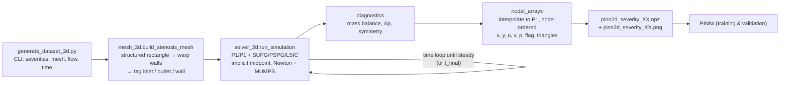

# CFD pipeline (`ns_cfd/`) — design notes

These notes explain what the CFD code in `ns_cfd/` does and why it was built the way it was.
Its job is to produce reference blood-flow fields for training and testing the PINN (see `PINN.md`).

---

## 1. What is in the folder

| File | Status | Role |
|---|---|---|
| `mesh_2d.py` | **in use** | 2D stenosed-channel mesh built directly in DOLFINx, boundaries tagged |
| `solver_2d.py` | **in use** | Incompressible Navier–Stokes solver (FEniCSx / DOLFINx 0.11) |
| `generate_dataset_2d.py` | **in use** | Command-line driver: mesh → solve → export `.npz` + plot for each severity |
| `output_2d/` | data | Datasets at Re ≈ 301 (u_max = 0.2 m/s), severities 20–75 % |
| `output_2d_re150/` | data | Datasets at Re ≈ 150 (u_max = 0.1 m/s), severities 20–70 % |
| `original_solver.py` | legacy | First 2D prototype; kept for reference only (see §7) |
| `mesh_generator.py`, `solver.py`, `generate_dataset.py` | incomplete | 3D pipeline (CadQuery + Gmsh); not runnable yet (see §8) |

Environment: conda env **`fenicsx-env`** (Python 3.11, DOLFINx 0.11, PETSc 3.25 with MUMPS).

---

## 2. Pipeline



Run:
```bash
conda activate fenicsx-env
cd ns_cfd
python generate_dataset_2d.py                                   # 25 / 50 / 75 %, Re ≈ 301
python generate_dataset_2d.py --severities 0.20 0.25 0.30 0.35 0.40 0.45 0.50
python generate_dataset_2d.py --u-max 0.1 --t-final 4.0 --output-dir output_2d_re150 \
       --severities 0.20 0.25 ... 0.70                          # Re ≈ 150
```

---

## 3. Geometry and mesh (`mesh_2d.py`)

**Geometry.** A straight 2D channel with a smooth, symmetric cosine stenosis:

```
r(x) = R · [1 − (s/2)·(1 + cos(π·(x − x_c)/L_s))]   for |x − x_c| ≤ L_s,   r = R elsewhere
```

`s` is the **severity, defined as the diameter reduction at the throat** (s = 0.5 means the throat
diameter is half the healthy diameter).

| Parameter | Default | Why |
|---|---|---|
| `radius` R | 2.5 mm (D = 5 mm) | Same healthy diameter as the original prototype; coronary/carotid order of magnitude |
| `length` L | 50 mm (10 D) | The original 30 mm domain was too short for the flow behind the stenosis to recover |
| `x_center` x_c | 10 mm (2 D) | Keeps the inlet 1.2 D before the stenosis starts; the original had only 5 mm |
| `half_length` L_s | 4 mm | Stenosis spans 6–14 mm, giving smooth walls without kinks |
| `nx × ny` | 250 × 40 | h ≈ 0.2 mm axially and 0.125 mm radially in the healthy section; finer at the throat |

**Mesh construction.** A structured triangular rectangle `[0, L] × [−R, R]` is generated, and each
node's y-coordinate is scaled by `r(x)/R`. Inlet, outlet and wall facets are tagged **after** the warp,
so the wall tag follows the curved boundary (inlet = 1, outlet = 2, wall = 3).

**Decision: no CadQuery / Gmsh for 2D.**
- In `fenicsx-env`, CadQuery cannot be imported (§8), and Gmsh is not installed.
- A warped structured mesh is enough in 2D, and its symmetric nodes make the symmetry check (§5) exact.
- The same analytic `r(x)` is re-implemented in the PINN. A unit test checks that it matches the CFD wall nodes to 1e-9.

---

## 4. Solver (`solver_2d.py`)

### Physics
Incompressible, Newtonian Navier–Stokes:

| Parameter | Value | Note |
|---|---|---|
| ρ | 1055 kg/m³ | blood density |
| μ | 0.0035 Pa·s | Newtonian blood viscosity (non-Newtonian effects ignored) |
| u_max | 0.2 m/s (also 0.1 m/s) | **peak** inlet velocity |
| Re = ρ·u_max·D/μ | **≈ 301** (≈ 150 for u_max = 0.1) | ⚠ based on the *peak* velocity; the mean-velocity Re is 2/3 of this (≈ 201 / 100) |

### Discretisation
- **Elements:** P1/P1 (equal-order) mixed velocity–pressure space. These are cheap, but they need stabilisation.
- **Stabilisation:** SUPG + PSPG + LSIC (residual-based, Tezduyar-type):
  - τ_M = [(2/Δt)² + (2|u|/h)² + (4ν/h²)²]^(−1/2), and τ_C = h|u|/2.
  - The LSIC term is multiplied by ρ. This fixes the original prototype, where the missing ρ made LSIC about 1000× too weak.
  - The viscous term is dropped from the strong residual, because second derivatives vanish for P1.
- **Time integration:** implicit midpoint for momentum, using u_mid = ½(uⁿ⁺¹ + uⁿ).
  - Continuity is imposed at n+1.
  - Pressure is treated as the n+½ Lagrange multiplier. The prototype averaged pressure in time, which can cause pressure oscillations.
- **Quadrature degree capped at 4.** UFL's automatic estimate for the `sqrt` inside τ_M is huge. Without the cap, Jacobian assembly took 0.8 s per call (about 10× slower overall), with no accuracy benefit for P1 fields.

### Boundary conditions
| Boundary | Condition | Why |
|---|---|---|
| Inlet (x = 0) | Parabolic Poiseuille profile u = u_max(1 − (y/R)²), **ramped** as ½(1 − cos(πt/t_ramp)), t_ramp = 0.1 s | Avoids the impulsive start of the prototype, which needs more Newton iterations and gives unphysical transients |
| Walls | No-slip u = 0 | Rigid vessel |
| Outlet (x = L) | "Do-nothing" (traction-free, so p ≈ 0) + backflow stabilisation −½ρ·min(u·n, 0)·(u·v) | No pressure Dirichlet condition is needed. The backflow term prevents blow-up if a vortex reaches the outlet |

### Nonlinear / linear solver
- Monolithic Newton through DOLFINx `NonlinearProblem` (PETSc SNES `newtonls`, basic line search).
  Tolerances: rtol 1e-8, atol 1e-10, at most 25 iterations, and an error is raised if it does not converge.
- Direct LU with MUMPS. The 2D systems are small (about 31k dofs), so a direct solver is the robust choice.
- `generate_dataset_2d.py` sets `OMP_NUM_THREADS=1`. With threaded BLAS inside MUMPS the CPU was
  oversubscribed: CPU time was about 9× wall time and runs were slower.

### Time loop and steady-state criterion
- Δt = 2 ms. Implicit midpoint is unconditionally stable, and SUPG's τ includes Δt.
- The run stops when the **relative change in velocity per step is below 1e-6** after the ramp has ended.
  Otherwise it stops at `t_final` (2 s by default; 4 s for Re ≈ 150, where the flow takes longer to develop).
- Steadiness is measured on **velocity only**. Pressure is close to zero when the ramp ends, so including
  it gave misleading relative changes.
- The dataset is the **steady** solution. Time snapshots are optional (`--snapshot-every N`), for future time-dependent PINNs.

---

## 5. Diagnostics stored with every case
| Quantity | Meaning |
|---|---|
| `mass_error` | \|Q_in − Q_out\| / Q_in from boundary flux integrals (about 1e-16 in all runs) |
| `dp` | Boundary-averaged pressure inlet − outlet [Pa] |
| `symmetry_error` | max\|u(x, y) − u(x, −y)\| / max\|u\| over mirrored nodes. About 1e-3 for symmetric flow, O(1) once the jet bends to one wall |
| `steady`, `t_end`, `final_rel_change` | Whether and when the steady criterion was met |
| `u_max_field` | Peak velocity in the domain |

---

## 6. Export format (`generate_dataset_2d.py`)
`pinn2d_severity_XX.npz` contains:

| Key | Content |
|---|---|
| `x, y` | Node coordinates [m] |
| `u, v, p` | Velocity [m/s] and pressure [Pa] at the nodes |
| `flag` | 0 = interior, 1 = inlet, 2 = outlet, 3 = wall (inlet/outlet take precedence at corners) |
| `triangles` | Mesh connectivity (for plotting / interpolation) |
| `meta` | JSON: all solver parameters, geometry, diagnostics (§5) |
| `t_snap, u_snap, …` | Only when `--snapshot-every` is used |

**Decision: interpolate to plain P1 spaces before export.** In a mixed space the solver's value
ordering does **not** match `domain.geometry.x`. The prototype's plot assumed it did: 496 of 561
values were drawn at the wrong node, so `stenosis_50_velocity.png` does not show the real flow.
The exporter interpolates u and p into P1 spaces that share one dofmap and takes coordinates from
that dofmap. Export is serial-only, since the meshes are small.

---

## 7. Results

### Re ≈ 301 (`output_2d/`, u_max = 0.2 m/s)
| Severity | Steady | Δp [Pa] | max\|u\| [m/s] | Symmetry error | Usable |
|---|---|---|---|---|---|
| 20 % | ✔ | 12.21 | 0.223 | 2.0e-3 | ✔ |
| 25 % | ✔ | 12.81 | 0.233 | 1.9e-3 | ✔ |
| 30 % | ✔ | 13.67 | 0.244 | 2.5e-3 | ✔ |
| 35 % | ✔ | 14.89 | 0.259 | 3.3e-3 | ✔ |
| 40 % | ✔ | 16.66 | 0.276 | 4.0e-3 | ✔ |
| 45 % | ✔ | 19.27 | 0.298 | 4.8e-3 | ✔ |
| 50 % | ✔ | 23.19 | 0.324 | 6.8e-3 | ✔ |
| 55 % | ✘ | 29.21 | 0.358 | 6.0e-2 | ✘ |
| 60–75 % | ✘ | 40–149 | 0.40–0.64 | 0.78–0.92 | ✘ |

### Re ≈ 150 (`output_2d_re150/`, u_max = 0.1 m/s, t_final = 4 s)
| Severity | Steady | Δp [Pa] | Symmetry error | Usable |
|---|---|---|---|---|
| 20–55 % | ✔ | 6.03 → 11.37 | 1.5e-3 – 3.5e-3 | ✔ |
| 60 % | ✔ (t = 1.64 s) | 14.07 | 5.9e-3 | ✔ |
| 65 % | ✘ | 18.36 | 7.3e-2 | ✘ |
| 70 % | ✘ | 26.30 | 0.72 | ✘ |

Sanity checks on the 50 % case at Re ≈ 301:
- The wall velocity is exactly 0.
- The velocity profile recovers to Poiseuille by the outlet (peak 0.209 m/s against 0.2 at the inlet).
- Backflow (u < 0) is captured behind the throat.

### Symmetry breaking: a physical limit, not a solver bug
Above a critical Re and severity, the 2D jet behind a stenosis bends towards one wall (a Coanda-type
bifurcation). The symmetric solution still exists but is unstable, so the solution is non-unique.
At Re ≈ 301 this starts at about **55 %**; at Re ≈ 150, at about **65 %**.
The PINN loader therefore rejects cases with `steady = False` or `symmetry_error > 0.05`.
Lowering Re is how the usable severity range was extended.

Runtime: a few minutes per case on one core. Higher severities take longer to reach steady state.

---

## 8. Legacy and unfinished code

**`original_solver.py` (prototype).** It runs under DOLFINx 0.11, but its outputs should not be used:
- the plot misplaces nodal values (§6);
- it runs only 0.03 s after an impulsive start, while one pass of fluid through the domain takes about 0.2 s, and `early_stop_tolerance` is never used;
- the inlet and outlet are too close to the stenosis;
- the LSIC term is missing ρ.

**3D pipeline (`mesh_generator.py`, `solver.py`, `generate_dataset.py`).** These are skeletons:
- `build_cadquery_solid` is undefined, and the O-grid meshing steps are only comments;
- `solver.py` never solves for pressure, applies no inlet BC, has its stabilisation commented out, and uses APIs that are removed or nonexistent in DOLFINx 0.11 (`FunctionSpace`, `gmshio`, `dolfinx.io.get_petsc_options`);
- `generate_dataset.py` passes point indices where DOLFINx expects cell indices to `Function.eval`.

**CadQuery cannot be imported in `fenicsx-env`.** `import cadquery` fails with
`libvtkWrappingPythonCore3.11.so: cannot open shared object file`:
- pip's `cadquery-ocp` requires `vtk==9.6.2`;
- conda's `vtk-base 9.6.2` satisfied that requirement on paper, so pip never installed its own VTK wheel;
- OCP links against the wheel's unversioned library names (`libvtkCommonCore.so`), but conda ships only versioned ones (`…-9.6.so`).

Recommended fix: a separate geometry environment (`mamba create -n cq-env -c conda-forge cadquery python-gmsh`)
that writes `.msh` files for `fenicsx-env` to read. Force-reinstalling pip's VTK over conda's is not recommended.

---

## 9. Known limitations / open items
- **No mesh-independence study has been done yet.** Δp and the symmetry-breaking thresholds should be checked on a finer mesh (for example 500 × 80).
- Rigid walls, Newtonian blood, steady inflow. No pulsatile waveform yet; `--snapshot-every` makes a time-dependent dataset possible.
- At high severities the off-centre jet still reaches the outlet. A longer domain (`--length 0.08`) would be needed there.
- Re is quoted with the peak inlet velocity. State this clearly when comparing with literature, which often uses the mean velocity.
