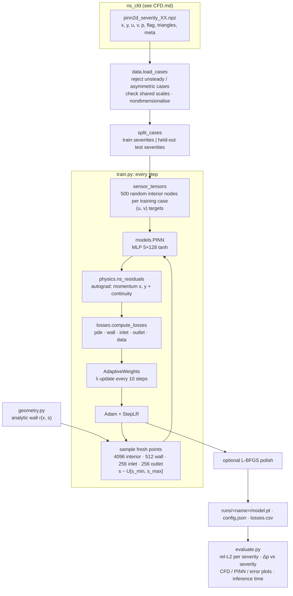

# PINN (`PINN/`) — design notes

These notes explain what the code in `PINN/` does, how it was designed, and the reasoning behind
each choice. The PINN learns the 2D stenosis flow fields produced by the CFD pipeline (see `CFD.md`).

---

## 1. Goal and the three main decisions

The network is a **single parametric surrogate**:

```
(x, y, severity)  →  (u, v, p)
```

It is trained on CFD cases at a few severities and can be evaluated at **any** severity in the
training range, including severities that have no CFD data.

| Decision | Choice | Why |
|---|---|---|
| Training approach | **Hybrid**: physics + boundary conditions + sparse CFD data | Purely physics-based PINNs are hard to train at Re ~150–300 with recirculation. A few velocity "sensors" stabilise training, and pressure can still be inferred from physics alone. This matches PINN_mvp and CardiovascularPINNs |
| Scope | **Parametric in severity** (not one network per case) | One model covers the whole severity range. The physics loss is applied at severities with no data, which helps interpolation |
| Boundary conditions | **Soft penalties with adaptive weights** | Works with any geometry (and later 3D) without building distance functions. The weights are tuned automatically by gradient statistics |

### References and what was taken from each
- **`old/PINN_mvp/juanes_pinn.py`** (lab MVP, linear elasticity):
  - Reused: the three-phase structure (data → hybrid training → benchmark against FEM for timing and L2 error), the idea of appending a parameter vector to the coordinates, and weighting a data loss against a PDE loss.
  - Not carried over: `f_x*2` instead of `f_x**2` (the "squared" residual was not squared, so the loss could go negative); the legacy `fenics` API used under a `dolfinx` import; a hard-constraint mask that reduced to the identity.
- **CardiovascularPINNs** (A. Aghaee & O. Khan, https://github.com/Owais-Khan/CardiovascularPINNs):
  - Adopted: one MLP that outputs all of (u, v, p); tanh/SIREN options with a 4 × 128 default; the loss `L_eqn + λ_bc·L_bc + λ_data·L_data` with gradient-based adaptive λ (every 10 epochs, EMA 0.9); Adam with betas (0.9, 0.99) and StepLR; mini-batched collocation points with full-batch wall and sensor points; velocity-only sensors.
  - Improved here:
    - **nondimensionalisation** (theirs feeds raw SI values);
    - explicit **inlet and outlet** loss terms (theirs enforces only wall no-slip);
    - command-line arguments that actually reach the code (theirs has hard-coded values that override the CLI).

---

## 2. Pipeline



Run (env `fenicsx-env`; PyTorch on CPU):
```bash
cd PINN
python -m pytest -q tests
python scripts/train.py --out-dir runs/hybrid --data-dir ../ns_cfd/output_2d_re150 --test-severities 0.35 0.55
python scripts/evaluate.py --run runs/hybrid
python scripts/train.py --out-dir runs/physics_only --lambda-data 0     # standard-PINN baseline
```

---

## 3. Code layout

| Module | Responsibility |
|---|---|
| `pinn/config.py` | `Config` dataclass with every hyperparameter. Each field is automatically a CLI flag (`--lambda-max 10`). Saved as `config.json` with each run |
| `pinn/scaling.py` | `Scales` (D, U, ρ, μ → Re, ρU²) and the nondimensional `Geometry`, both read from the CFD `meta` |
| `pinn/geometry.py` | Analytic wall `r(x, s)` (same formula as `ns_cfd/mesh_2d.py`) and samplers for interior, wall, inlet and outlet points |
| `pinn/data.py` | Loads `.npz` cases, validates them, nondimensionalises, splits train/test, samples sensors |
| `pinn/models.py` | The `PINN` MLP. Input scaling to [−1, 1] is stored inside the model; options for SIREN and Fourier features |
| `pinn/physics.py` | Steady Navier–Stokes residuals via `torch.autograd` |
| `pinn/losses.py` | Loss terms and `AdaptiveWeights` |
| `pinn/train.py` | Training loop, checkpoints, `losses.csv`, monitoring of held-out error |
| `pinn/evaluate.py` | Metrics, plots, Δp curve, inference timing → `metrics.json` |
| `scripts/` | Command-line entry points |
| `tests/` | Unit tests (§9) |

---

## 4. Nondimensionalisation

```
x* = x / D     u* = u / U     p* = p / (ρU²)     Re = ρUD/μ
(u*·∇)u* + ∇p* − (1/Re)∇²u* = 0,      ∇·u* = 0
```
D is the healthy diameter (5 mm) and U the peak inlet velocity, so Re ≈ 301 (u_max = 0.2) or 150.7 (u_max = 0.1).

**Why:**
- In SI units the coordinates are about 1e-3 m, velocities about 0.1 m/s and pressures about 10 Pa. Values that far apart give badly scaled gradients and losses.
- In nondimensional form all variables are O(1), and the only physical parameter is Re.
- Scales are read from the dataset's `meta`, and the loader refuses to mix cases with different scales.

In nondimensional units the domain is x* ∈ [0, 10], |y*| ≤ r(x*, s) ≤ 0.5, and the inlet profile is u* = 1 − (y*/0.5)².

---

## 5. Network
| Setting | Default | Why |
|---|---|---|
| Inputs | (x*, y*, s), mapped to [−1, 1] inside the model | The input box (domain plus severity range) is saved with the checkpoint, so inference needs no separate scaler |
| Outputs | (u*, v*, p*) from one network | Velocity and pressure share features, as in CardiovascularPINNs |
| Hidden layers | 5 × 128 | Slightly deeper than CardiovascularPINNs' 4 × 128, because severity adds an input dimension |
| Activation | tanh, Xavier-normal init, zero bias | Smooth, with well-behaved second derivatives (the Laplacian is needed) |
| Options | `--activation sine` (SIREN, ω₀ = 30, Sitzmann init); `--fourier-features N` (random Fourier embedding of x, y) | For sharper features if tanh turns out too smooth. Not used in the runs so far |

---

## 6. Loss function

```
L = L_pde + λ_wall·L_wall + λ_inlet·L_inlet + λ_outlet·L_outlet + λ_data·L_data      (all MSE)
```

| Term | Points | Condition | Note |
|---|---|---|---|
| `pde` | 4096 interior points per step | momentum residuals in x and y, plus continuity | Derivatives are spatial only; s is treated as a parameter |
| `wall` | 512 on the analytic wall | u = v = 0 | No-slip |
| `inlet` | 256 at x = 0 | u = 1 − (y/R)², v = 0 | Same profile as the CFD; a unit test checks this |
| `outlet` | 256 at x = L | p = 0 | Consistent with the CFD's traction-free outlet |
| `data` | 500 CFD nodes × each training severity | u, v (and p only with `--data-pressure`) | **Pressure is not supervised by default** |

**Why velocity-only data.** It mimics realistic measurements (velocity from 4D-flow MRI or Doppler),
and it tests whether the PINN can *infer* pressure, which is the clinically interesting output (Δp /
FFR-like quantities). CardiovascularPINNs uses the same setup.

### Sampling decisions
- Collocation points are **redrawn every step**, which covers the domain better than a fixed set.
- 30 % of interior points (`focus_frac`) are concentrated in x ∈ [x_c − L_s, x_c + 4 L_s]. That covers the throat and the recirculation zone, where gradients are largest.
- y is drawn uniformly within the local lumen, so point density is naturally higher at the throat.
- Severity is drawn **continuously** over [min, max] of *all* loaded cases, including held-out ones.
  The physics is therefore enforced at severities with no data; this is what makes the surrogate interpolate.
- Sensor locations are fixed for a run (random interior CFD nodes, with a fixed seed) and used full-batch every step.

### Adaptive weights (`AdaptiveWeights`)
Learning-rate annealing (Wang, Teng & Perdikaris, 2021), as in CardiovascularPINNs:
```
λ_k ← 0.9·λ_k + 0.1 · max|∇θ L_pde| / mean|∇θ L_k|        every 10 steps,  clamped to [1e-3, λ_max]
```
- A term whose initial λ is 0 stays off. `--lambda-data 0` therefore gives a standard physics-only PINN for ablation.
- `--no-adaptive` keeps fixed λ values.
- **`λ_max` turned out to be the critical hyperparameter (§8).**

---

## 7. Optimisation and data split
| Setting | Value | Note |
|---|---|---|
| Optimizer | Adam, lr 1e-3, betas (0.9, 0.99) | As in CardiovascularPINNs |
| LR schedule | StepLR ×0.5 every 4000 steps | |
| Steps | 20k Adam | About 2 h on CPU |
| L-BFGS | 2000 iterations (`--lbfgs-steps 0` turns it off) | Full-batch polish on one fixed sample with λ frozen. Lowered velocity error from about 0.55 % to 0.32 % in the full runs, for about 13 min |
| λ_max | **10** | Validated (§8). The original 1e3 cap starved the physics term |
| Precision / seed | float32, seed 0 | Reproducible sampling and sensor selection |
| Held-out severities | **0.35, 0.45** at Re ≈ 301 (default); **0.35, 0.55** at Re ≈ 150 | Held out completely: no sensor data, used only to measure interpolation. The originally planned 0.55 had to change at Re ≈ 301 because that case is asymmetric |
| Case rejection | `steady = False` or `symmetry_error > 0.05` | Asymmetric (bifurcated) flows are non-unique, and a smooth surrogate in s should not straddle them |

Usable training ranges are therefore **20–50 % at Re ≈ 301** (7 cases) and **20–60 % at Re ≈ 150** (9 cases).
The CFD stability test (`CFD.md` §9) confirmed these limits are physical: above them the symmetric
flow is unstable and the real flow is an asymmetric jet with two mirror-image solutions.

**Compute.** CPU only (no GPU on this machine):
- about **0.34 s per step** for a single run with 8 threads, which is roughly 2 h for 20k steps;
- about 0.78 s per step each when two runs share the CPU, so run them one after another;
- the laptop suspends overnight, so wrap long runs in `systemd-inhibit --what=sleep:idle … sleep 5h`.

---

## 8. Results

Metrics:
- relative L2 error over all CFD nodes for velocity (u, v together), u, v and p;
- Δp = mean p on inlet nodes − mean p on outlet nodes, compared with the same quantity from CFD.

### Run 1: `runs/hybrid_s20-50` (Re ≈ 301, 20k steps, λ_max = 1e3)
| Severity | Split | Velocity L2 | p L2 | Δp CFD | Δp PINN | Δp error |
|---|---|---|---|---|---|---|
| 0.20 | train | 0.46 % | 50 % | 12.2 Pa | 6.9 Pa | 43 % |
| 0.35 | **test** | 0.44 % | 38 % | 14.9 Pa | 11.7 Pa | 21 % |
| 0.45 | **test** | 0.99 % | 23 % | 19.3 Pa | 14.9 Pa | 22 % |
| 0.50 | train | 1.92 % | 27 % | 23.2 Pa | 16.4 Pa | 30 % |

### Run 2: `runs/hybrid_re150_s20-60` (Re ≈ 150, 20k steps, λ_max = 1e3)
Velocity L2 is 0.4–1.6 % (held-out 0.46 % and 1.01 %). p L2 is 40–63 %, and Δp is underestimated by 24–44 %.

**Velocity is excellent, and held-out severities are as accurate as training ones, so the surrogate
interpolates correctly. Pressure was underestimated.**

### Diagnosis
Most of Δp is not caused by the stenosis. It is the **viscous Poiseuille loss** along the 10-D channel:
dp*/dx* = −8/Re per diameter, which is about 11 Pa of the 12 Pa at 20 % (Re ≈ 301).
- All adaptive λ hit the 1e3 cap by about step 4k. The physics was then weighted 1/1000 relative to the data and boundary terms.
- The PDE loss stalled at about 1e-2, an RMS residual of about 0.1. That is roughly four times larger than the viscous pressure gradient it should resolve.
- Velocity is pinned by the data, but pressure is informed only by the physics, so the viscous Δp was lost.

### Check run: `runs/check_re150_lmax10_5k` (Re ≈ 150, **λ_max = 10**, only 5k steps)
| | Run 2 (20k steps, λ_max 1e3) | Check (5k steps, λ_max 10) |
|---|---|---|
| p L2 | 40–63 % | **11–19 %** |
| Δp error, held-out 0.35 / 0.55 | 28 % / 33 % | **2.1 % / 6.3 %** |
| Velocity L2 | 0.4–1.6 % | 1.7–5.2 % (still decreasing at 5k) |
| Final PDE loss | 1.5e-2 | 4.5e-3 |

This confirms the diagnosis. There is a **trade-off**: a lower cap gives better physics and pressure
but less weight on data and boundaries, so velocity is somewhat worse at equal steps.

### Full rerun: `runs/full_re301_lmax10` and `runs/full_re150_lmax10` ✔ current best
Configuration: λ_max = 10, 20k Adam steps + 2000 L-BFGS, trained on the **regenerated datasets on the
symmetric `crossed` CFD mesh** (20,291 nodes per case). These settings are now the code defaults.

**Re ≈ 301** (held out: 0.35, 0.45)

| Severity | Split | Velocity L2 | p L2 | Δp CFD | Δp PINN | Δp error |
|---|---|---|---|---|---|---|
| 0.20 | train | 0.28 % | 1.9 % | 12.22 Pa | 12.13 Pa | 0.7 % |
| 0.25 | train | 0.21 % | 2.5 % | 12.82 Pa | 12.58 Pa | 1.9 % |
| 0.30 | train | 0.23 % | 2.9 % | 13.67 Pa | 13.41 Pa | 1.9 % |
| **0.35** | **test** | 0.26 % | 2.3 % | 14.88 Pa | 14.79 Pa | **0.6 %** |
| 0.40 | train | 0.29 % | 2.1 % | 16.64 Pa | 16.86 Pa | 1.3 % |
| **0.45** | **test** | 0.38 % | 2.6 % | 19.23 Pa | 19.61 Pa | **2.0 %** |
| 0.50 | train | 0.58 % | 4.0 % | 23.11 Pa | 22.85 Pa | 1.1 % |

**Re ≈ 150** (held out: 0.35, 0.55)

| Severity | Split | Velocity L2 | p L2 | Δp CFD | Δp PINN | Δp error |
|---|---|---|---|---|---|---|
| 0.20 | train | 0.34 % | 4.5 % | 6.03 Pa | 5.85 Pa | 2.9 % |
| 0.25 – 0.30 | train | 0.27–0.28 % | 2.0–3.2 % | | | 0.8–1.7 % |
| **0.35** | **test** | 0.28 % | 0.95 % | 6.99 Pa | 6.97 Pa | **0.3 %** |
| 0.40 – 0.50 | train | 0.27–0.34 % | 0.6–1.3 % | | | 0.1–1.2 % |
| **0.55** | **test** | 0.43 % | 1.2 % | 11.35 Pa | 11.42 Pa | **0.7 %** |
| 0.60 | train | 0.67 % | 3.5 % | 14.03 Pa | 13.52 Pa | 3.6 % |

Compared with runs 1 and 2:
- **Pressure error fell by 10–50×**: p L2 dropped from 23–63 % to 0.6–4.5 %, and Δp error from 20–44 % to 0.1–3.6 %.
- **Velocity also improved** (0.21–0.67 % against 0.4–1.9 %), so the λ_max trade-off seen in the 5k check disappears with full training plus L-BFGS. A cap of 30 is not needed.
- Final PDE loss is 4–7e-4, far below the viscous pressure-gradient scale 8/Re ≈ 0.027–0.053.
- **Held-out severities are as accurate as training ones** (Δp 0.3–2.0 %), so the surrogate interpolates in severity.
- The edges of the severity range remain the weakest: 0.20 and 0.60 at Re ≈ 150 have Δp errors of 2.9 % and 3.6 %. The largest local pressure errors (about 0.2 Pa) sit at the throat wall.
- The remaining PINN pressure error (0.6–4.5 %) is now comparable to the CFD mesh error (0.2–0.9 % field, GCI ≤ 1.6 % on Δp; see `CFD.md` §9).

Training took 2.1–2.2 h per run (8 CPU threads). Inference takes about 38 ms for all 20k nodes of a case, compared with minutes for the CFD.

---

### Seed variance and physics-only ablation (Re ≈ 150; `runs/comparison_re150.md`)
Made with `scripts/compare_runs.py`. "Hybrid" = the full configuration over 3 seeds (0, 1, 2), shown
as mean ± std. A different seed changes the network initialisation, the sensor locations and the
collocation sampling. "Physics-only" = the same configuration with `--lambda-data 0`.

| | Hybrid, train | Hybrid, **held-out** | Physics-only, train | Physics-only, held-out |
|---|---|---|---|---|
| Velocity L2 | 0.38 ± 0.03 % | 0.40 ± 0.05 % | 18.4 % | 24.0 % |
| Pressure L2 | 2.45 ± 0.19 % | 1.22 ± 0.15 % | 41.7 % | 46.7 % |
| Δp error | 1.80 ± 0.25 % | 0.47 ± 0.02 % | 42.0 % | 51.9 % |

- **The results are robust to the seed.** The spread between seeds is small compared with the
  effects discussed above. The weakest case is consistently the 60 % edge (Δp error 4.9 ± 1.1 %).
- **The data term is essential at this Re.**
  - Physics-only is reasonable at 20 % (velocity 4 %) but degrades steadily with severity: velocity 44 % and Δp 78 % at 60 %.
  - Without data, the network does not find the jet and recirculation that the stenosis creates.
    This is the known difficulty of physics-only PINNs at moderate Re.
  - This is the main argument for the hybrid approach.
  - Caveat: physics-only used the hyperparameters tuned for the hybrid model. A dedicated physics-only
    setup (more steps, Re or severity curriculum, Fourier features) might do better, but it is unlikely to close a gap this large.

## 9. Tests (`python -m pytest -q tests`, 9 tests)
| Test | What it guarantees |
|---|---|
| `test_physics.py` | The exact Poiseuille solution gives zero residual (< 1e-12); a flipped pressure sign is detected; residuals backpropagate to the network weights |
| `test_geometry.py` | The analytic wall `r(x, s)` matches CFD wall nodes to 1e-9; sampled points lie inside the lumen |
| `test_data.py` | The nondimensional round-trip is exact; CFD inlet nodes carry the PINN's inlet profile; bifurcated cases are rejected; the train/test split leaks no held-out severity into the sensors |

---

## 10. Next steps / open items
1. ~~Stability test~~ ✔ done: the severity limits are physical; the ranges stay.
2. ~~Physics-only ablation~~ ✔ done: the data term is essential.
3. ~~Seeds~~ ✔ done for Re ≈ 150 (Re ≈ 301 seeds optional).
4. Sensor studies: fewer sensors (50–100 per case), added noise, and placement like MRI planes. This is now the main open question for realism.
5. Improve the edges of the severity range (0.20 and 0.60 have the largest errors), for example with more collocation points or sensors near the range ends.
6. The v-component relative L2 is large (5–17 %) because v ≈ 0 almost everywhere. Judge it by absolute error or by the velocity-vector L2.
7. Extensions: pulsatile flow (time as an input, using CFD `--snapshot-every`), Re as a second parameter, and 3D (see `old/ns_cfd_3d/`).
